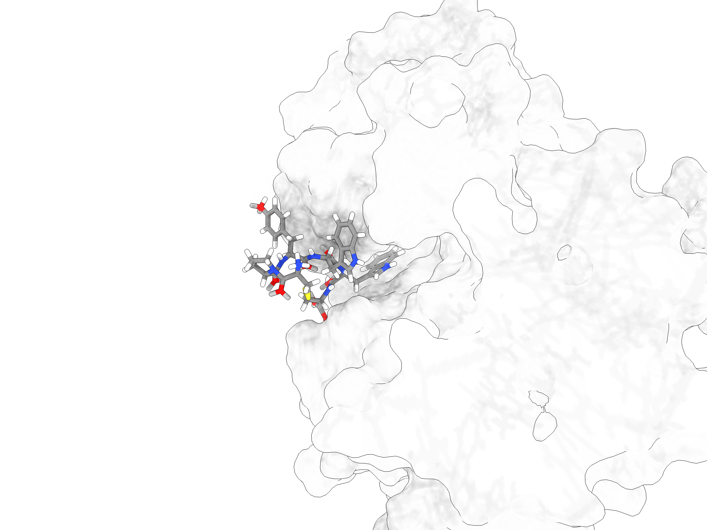

# Apinya Sintavee

**Computational Drug Discovery | Structural Bioinformatics | Scientific Computing**

M.Sc. student in Genetic Engineering and Bioinformatics, Kasetsart University, Thailand
[Email](mailto:sintavee406@gmail.com) · [Research portfolio](https://sintavee406-hash.github.io/computational-biology-portfolio/) · [Project index](PROJECTS.md)

I build reproducible computational workflows that connect molecular structure, virtual screening, simulation, and data analysis. My graduate research investigates cyclic hexapeptides across JAK1, JAK2, and JAK3. I also work on enzyme-inhibitor screening, network pharmacology, and research software.

## Featured research

### Computational Prioritization of Cyclic Hexapeptides for JAK1, JAK2, and JAK3 Using Molecular Docking, Machine Learning, and Molecular Dynamics

This thesis combines a CX4C cyclic-peptide library, GPU-accelerated docking against three JAK-family targets, sequence-based machine learning, pose and interaction assessment, and molecular dynamics (MD) of prioritized complexes. Docking and ML scores are **computational prioritization signals**, not measured potency or confirmed biological selectivity.

| Research stage | What I do | Public example |
| --- | --- | --- |
| Library and docking | Generate cyclic-peptide structures; prepare receptors and ligands; run and quality-check target-specific screening | [Docking-score distributions](docs/assets/docking-distributions.png) |
| Data analysis and ML | Compare score profiles; encode peptide sequences; validate predictive models against docking-derived labels | [Model validation](docs/assets/ml-validation.png) |
| Structural interpretation | Inspect peptide poses and binding-site contacts in three dimensions | [JAK1 pocket, wide](docs/assets/jak1-pocket-wide.png) · [close](docs/assets/jak1-pocket-close.png) |
| MD follow-up | Assess complex behavior with trajectory-based structural measures | [Earlier completed three-peptide panel](docs/assets/peptide-rmsd.png) |

The completed MD example above covers **CPYWWC, CGGWWC, and CWGGWC** across JAK1/2/3 (three independent 100 ns trajectories per complex). A separate, expanded five-peptide × three-JAK study is ongoing; its outcomes are not presented as complete here. See the [research note](jak_project_summary.md) for scope, interpretation, and disclosure boundaries.

*JAK1 surface and docked CPYWWC pose from the earlier completed study. This illustration supports structural interpretation, not a claim of experimental inhibition.*

## Other research

These projects are described by **question, workflow, and skills**, without unpublished results.

| Project | Approach |
| --- | --- |
| [Topaz formulation: BPH and ED](PROJECTS.md#topaz-formulation-and-network-pharmacology) | GOLD docking, compound-target mapping, PPI networks, GO/KEGG enrichment |
| [Tyrosinase cyclic-peptide screening](PROJECTS.md#tyrosinase-cyclic-peptide-screening) | Large-library sequence QC, docking-data analysis, SQL, ML |
| [Acetylcholinesterase](PROJECTS.md#acetylcholinesterase-ache) | Pyridoquinoxaline docking with PDB 7E3H and donepezil reference |
| [Pancreatic lipase](PROJECTS.md#pancreatic-lipase) | Inhibitor screening, catalytic-triad interpretation, orlistat reference |
| [Alpha-amylase](PROJECTS.md#alpha-amylase) | Docking and catalytic-residue analysis with PDB 1B2Y |
| [Alpha-glucosidase](PROJECTS.md#alpha-glucosidase-mgam) | MGAM inhibitor screening with PDB 2QMJ |
| [Leishmania CYP51](PROJECTS.md#leishmania-cyp51) | Target-structure assessment for inhibitor discovery |

## Research software

- **Ligand Fetcher:** retrieves and prepares ligand structures for structure-based workflows, with source and chemistry checks.
- **Cyclic-Peptide Library Generator:** builds cyclic-hexapeptide structures for high-throughput computational screening.

The public repository contains [small educational analysis scripts](peptide_sequence_analysis.py) and documentation. Full thesis datasets, trajectories, proprietary software inputs, and unpublished partner-project results are intentionally not distributed.

## Methods and tools

**Structure-based discovery:** receptor and ligand preparation, virtual screening, reference-guided docking, pose assessment, protein–ligand and protein–peptide interaction analysis; AutoDock-GPU/AutoDock4, GOLD/ChemPLP, AutoDock Vina, PyMOL, ChimeraX.

**Simulation:** GROMACS molecular dynamics, trajectory quality control, structural follow-up with RMSD and interactions, Linux/WSL and GPU computing.

**Data and machine learning:** Python, pandas, NumPy, R, SQL, scikit-learn, peptide-sequence features, model validation, statistical summaries, scientific visualization, and workflow automation.

**Bioinformatics and software:** sequence analysis, structural databases, cheminformatics, RDKit, PeptideBuilder, chemical-data APIs, network pharmacology, Cytoscape, STRING, and GO/KEGG enrichment.

## Contact

I am interested in computational drug discovery, CADD, structural bioinformatics, and AI drug discovery roles. I am especially drawn to teams connecting molecular data and machine learning with experimental validation. Contact me at **[sintavee406@gmail.com](mailto:sintavee406@gmail.com)**.
