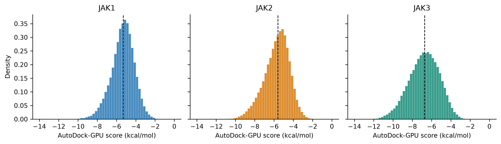
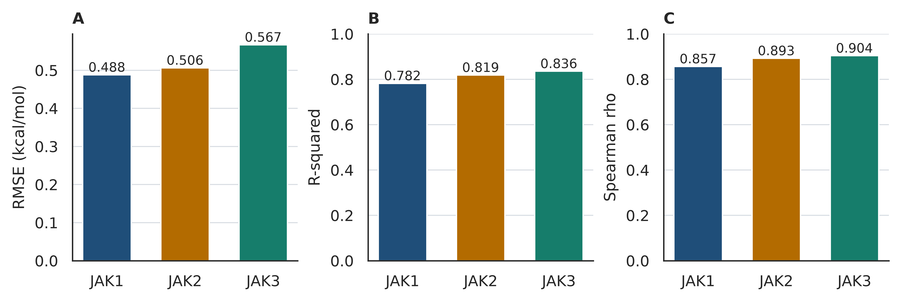
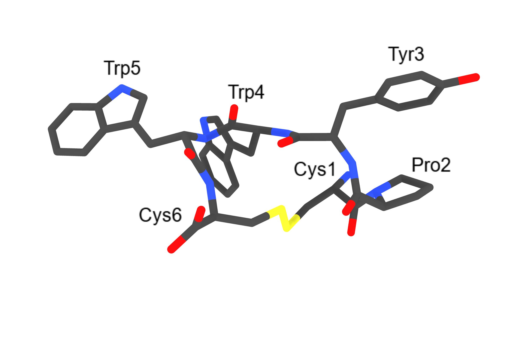
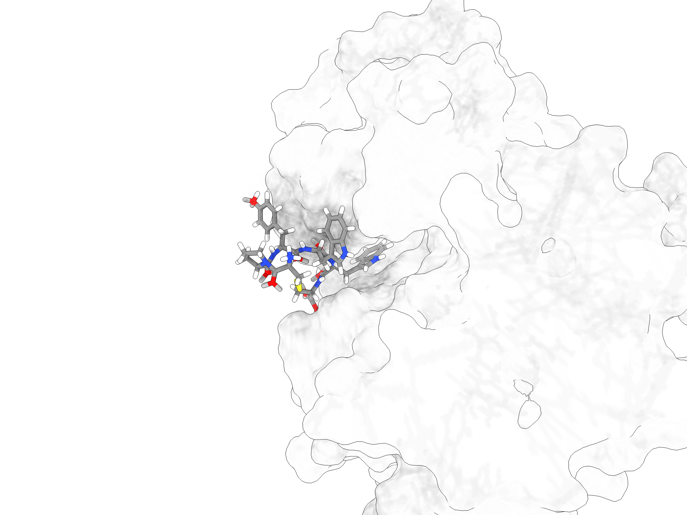
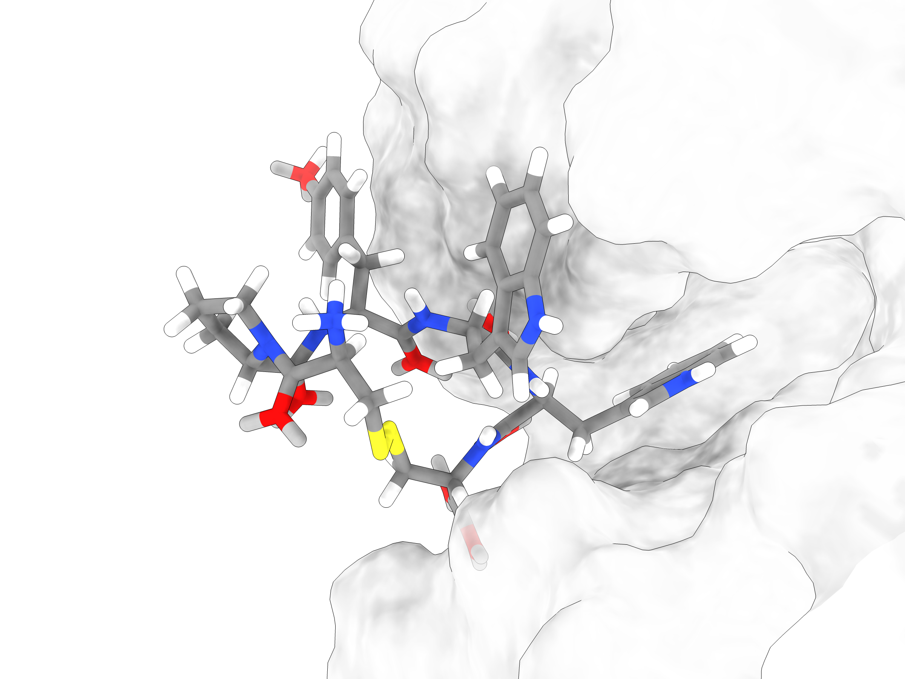
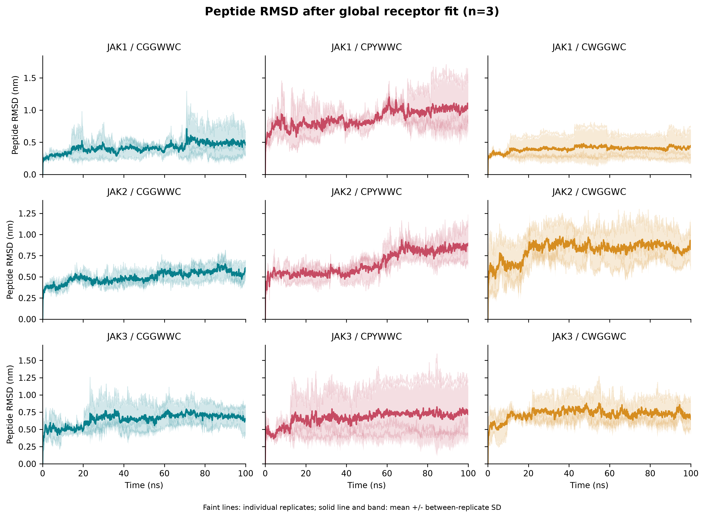

# Cyclic Hexapeptides across JAK1, JAK2, and JAK3

**Computational Prioritization of Cyclic Hexapeptides for JAK1, JAK2, and JAK3 Using Molecular Docking, Machine Learning, and Molecular Dynamics**

Apinya Sintavee · Graduate research, Kasetsart University

## Background

JAK-family kinases are related therapeutic targets. Their structural similarity makes cross-target interpretation important when prioritizing candidate inhibitors. Cyclic peptides offer a constrained chemical space, but docking-based ranking alone cannot establish biochemical potency or cellular selectivity.

## Objectives

1. Build and screen a 160,000-sequence CX4C cyclic-hexapeptide library against JAK1, JAK2, and JAK3 kinase structures.
2. Examine docking-score profiles, pose quality, and protein–peptide contacts across targets.
3. Test whether peptide sequence features predict docking-derived outcomes under appropriate validation.
4. Use selected MD trajectories to examine the behavior of prioritized complexes, without treating MD as a direct assay of inhibition.

## Methods

I wrote code to enumerate the four variable CX4C positions over 20 amino acids, producing 20^4 = 160,000 distinct sequences, and to generate cyclic-peptide structures for the screening library. The workflow then spans structural checks; protein and ligand preparation; GPU-accelerated docking; score-distribution and cross-target analysis; sequence encoding and ML validation; three-dimensional pose inspection; and GROMACS-based MD follow-up. Target-specific docking baselines are evaluated within their own score distributions. Visualized poses are illustrative; a pose or contact is not by itself evidence of biological activity.

The completed *earlier* MD panel includes CPYWWC, CGGWWC, and CWGGWC against JAK1/2/3, with three 100 ns trajectories per complex. An *expanded* five-peptide × three-JAK MD study is a separate ongoing effort; no completed results from it are claimed here.

## Selected results and visual evidence

Only a small, authorized selection of figures is shared. These are not the complete thesis dataset.

### Docking-score distributions

*Target-wise docking-score distributions. Dashed lines mark within-target distribution centers in the original analysis. Score differences across targets require calibration and structural interpretation; they are not measured binding affinities.*

### Machine-learning validation

*Selected validation metrics for models trained on docking-derived labels. These metrics describe agreement with computational labels, not experimental inhibition.*

### Structural interpretation: JAK1–CPYWWC

| Peptide structure | Binding-pocket context |
| --- | --- |
|  |  |

*An earlier completed CPYWWC case study. The sequence drawing and wide/close pocket views represent the same peptide–target example.*

### Earlier MD panel: peptide RMSD

*Peptide RMSD after global receptor alignment for the earlier CPYWWC/CGGWWC/CWGGWC × JAK1/2/3 panel. Faint traces represent independent trajectories; the bold trace and band summarize the three trajectories. RMSD is a structural descriptor, not an affinity estimate.*

## Discussion and boundaries

The purpose of the combined workflow is **candidate prioritization**. Docking supports comparative screening, ML reveals patterns in docking-derived labels, structural inspection helps evaluate pose plausibility, and MD adds dynamic context for selected complexes. None of these computational outputs alone demonstrates JAK inhibition or clinical selectivity. Prospective biochemical assays and orthogonal validation remain necessary.

This portfolio omits raw high-throughput docking outputs, trajectories, model artifacts, unpublished partner results, and licensed software inputs. Figures are selected examples from completed analyses; the ongoing expanded MD panel is not represented as finished.
